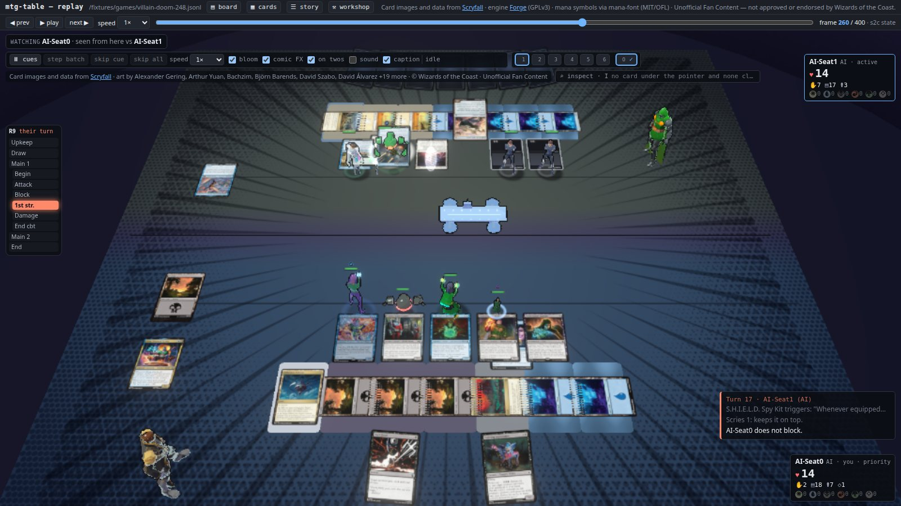
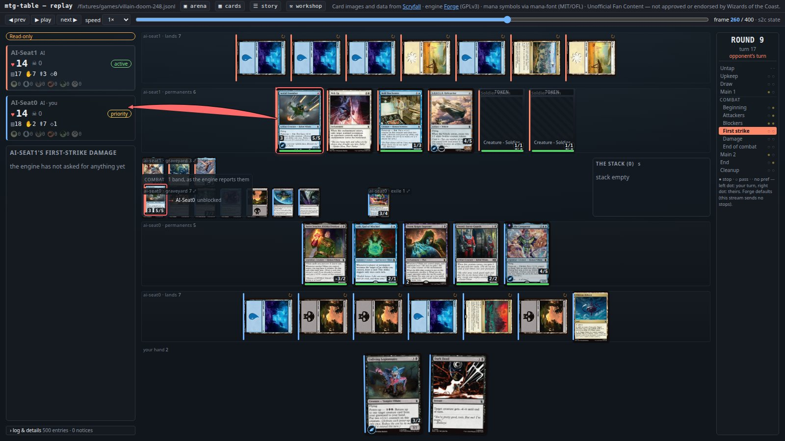

# mtg-table

A local, single-player browser client for *Magic: The Gathering*. It runs the open-source
[Forge](https://github.com/Card-Forge/forge) engine headless in a JVM on your own machine, as the rules engine and
the AI opponent, and puts a TypeScript/React board in a browser tab in front of it. The two halves talk JSON over a
WebSocket bound to `127.0.0.1`. The browser holds **no rules logic at all**: Forge already knows what is legal,
targetable and payable, the Java bridge serialises that into a redacted snapshot (your opponent's hand never
leaves the engine), and the board renders it. A button is enabled only when the engine says so, and every click
is judged by the engine. The wire protocol, [`docs/protocol.md`](docs/protocol.md), is the real specification:
the Java emitter and the TypeScript reducer are both written against it.





The same frame stream drives both: the 2D board and the 3D arena are two renderers, and `V` switches between them
mid-game.

## Quickstart

You need Ubuntu (or a similar Linux), an OpenJDK 21 **JRE** (no JDK, Maven or Gradle), Node 24, and your own
install of **Forge 2.0.14**: Forge's `.tar.bz2` distribution extracted as-is into `~/forge`, with
`forge-gui-desktop-2.0.14-jar-with-dependencies.jar` and `res/` side by side. This repository never downloads or
ships Forge; it is pinned to that one build by sha256 (`3c0a7c38…8e5dd9`, the full hash in the
[handbook](docs/handbook.md#getting-the-engine)). If yours is elsewhere, edit `forgeJar` in `config.json` or export
`FORGE_JAR`.

```bash
npm --prefix web ci              # the board's dependencies
./tools/make-forge-home.sh       # once: a Forge home under var/, so ~/.forge is never touched
./tools/check-forge.sh           # must print the pinned sha256
./bridge/build.sh                # the lints, javac (from the JRE) and the bridge's self-tests
./scripts/play.sh                # the bridge and the board: open the URL it prints
./scripts/play.sh --arena        # the same game, in 3D
./scripts/spectate.sh            # watch two AIs play, followed live in the arena
./tools/check-all.sh             # the full gate, before calling any change done
```

Everything else (the console game, replays, the narrator, the card library, the cube lab, the gate's steps) is in
the [handbook](docs/handbook.md) and [`tools/README.md`](tools/README.md)'s *Commands, by task*.

## The move atlas dataset

The move atlas measures what each option of a Magic decision is worth by forking the real game at that decision,
forcing each option the engine listed, and playing the rest of the game out many times: with random play on both
sides (the *random map*) and, on some games, with Forge's AI on both sides (the *Forge map*). A decision's
*regret* is how much better the best option scored than the one Forge's own AI chose, with a bootstrap interval;
a label is *confident* when that interval lies above zero.

Release **v1** holds **1,003 decision rows** (508 complete labels, **154 confident**, 222 partial) from **77
games** between random 40-card decks, with **338,895 branch games** behind them and the 154 decks they played,
from six lab nights of one frozen seat population ([D508](docs/decisions/D508-last-known-copy-judged-where-the-card-is.md),
[D509](docs/decisions/D509-seat-frozen-between-landings.md)). It is scrubbed: card names stay, card rules text and
every machine path do not, and a check fails the build otherwise.

- **What it is and how to make it again:** [`docs/guides/move-atlas.md`](docs/guides/move-atlas.md) (the pipeline,
  one spine on your own machine, every field of a row) and
  [D515](docs/decisions/D515-publish-the-atlas.md) (the decision, the exclusions, the scrub).
- **The generator:** `tools/atlas/` (`release.py` builds the release; its tests run in the gate).
- **Where to get it:** the release zip is attached to the GitHub release, and listed on Kaggle and Hugging Face,
  once the owner uploads it.
- **Licence:** the measurements CC BY 4.0 (attribute as *mtg-table move atlas,
  https://github.com/jalirkan/mtg-table*); the generator GPL-3.0-or-later; card names under Wizards of the Coast's
  Fan Content Policy, not licensed by the release. Cite it with [`CITATION.cff`](CITATION.cff).

## How this is built

The code in this repository — the Java bridge, the TypeScript client, the tools and the tests — was written with
Claude, Anthropic's AI model, working in Claude Code under the owner's direction and review. The owner decides what
is built and settles every open question (PLAN.md's *Only the user can decide*); each piece of work is a lane on a
branch of its own, read by an independent reviewing session before it merges, and nothing reaches `main` without
the full gate green (**D201**). Pushes, releases and anything public are the owner's. The conventions those
sessions work to are `CLAUDE.md` and its per-directory companions (`bridge/`, `web/`, `web/src/arena/`, `tools/`),
which double as a map of the code for a human reader. [CONTRIBUTING.md](CONTRIBUTING.md) is how a change lands.

## NON-GOALS

These are not "later". They are decisions, and they are what keeps this project finishable. Anything on this list
is a closed question, not a backlog item.

- **No multiplayer.** One human seat, one AI seat, one JVM, one browser tab. No
  lobby, no matchmaking, no spectators, no second human. *Lifted in part on
  2026-10-01 by **D280**, on the owner's approval:* `ws://127.0.0.1:8642/observe`
  is a read-only copy of the seat's own frames for any number of local followers
  (ForgeCoach), which can never act, answer or hold the seat (amendment M50).
  Still a no: a second seat, a second human, a lobby, and any view the seat
  itself is not shown. *Lifted in part on 2026-10-06 by **D400**, on the owner's
  request:* two people may grid-draft a cube from their own browsers through the
  coach helper's draft room (`play.sh --draft-room`, `docs/draft-room.md`), on a
  port of its own where every route needs a seat token — on the Wi-Fi, through a
  Cloudflare tunnel (`docs/cloudflare.md`) or through Tailscale Funnel
  (`./scripts/play.sh --funnel`, `docs/tailscale-funnel.md`, D409). *And again the same day by
  **D402** and **D403**, on the owner's request:* the two drafted decks may be
  played against each other — `MtgTable --humans 2`, two human seats and no AI,
  each its own redacted stream on a table port where every seat needs its own
  per-game token (amendment M59), a best of three that the room runs one game at
  a time (D406), each seat recorded only with its player's consent (D407). Two
  people, no spectators: a lobby, a third seat and a view of both hands are still
  a no.
- **No deck builder.** Decks are `.dck` files you already have. Editing them is
  Forge's job, or a text editor's.
- **No card-library package.** Nothing published, nothing the engine, the bridge
  or the board depends on: the board's card art is still a generated `art.json`
  for the decks in play. *Lifted in part on 2026-09-27 by **D90**, on the user's
  request:* a local card index (`tools/card-library/` — SQLite + FTS5 over
  Scryfall's bulk file, and an image cache, all under `var/cards/`) and a card
  browser at `#cards` now exist as **tools**. What is still a no: a package, a
  route outside the Vite dev server, any proxy of Scryfall, and any deck editing.
- **No accounts, no auth, no sessions, no users.** The socket binds loopback and
  trusts whatever connects — except a web page from an origin it was not told
  about (**D281**): a browser's upgrade to `/ws` or `/observe` must carry an
  `Origin` on `config.json`'s `wsAllowedOrigins` (loopback on any port and
  `https://jalirkan.github.io` by default), or it is refused 403, so a page you
  happen to have open cannot take the seat. That is the security model.
  *Lifted in part on 2026-10-01 by **D287**, on the owner's approval:* LAN play
  (`./scripts/play.sh --lan`, amendment M51) puts a per-run pairing token in front
  of every request from another machine. It is a shared secret in a URL, not an
  account, and still a no: users, logins, sessions that outlive a run.
- **No packaging, no installer, no Docker, no release artifact.** You run it from
  the checkout with the commands above. Forge stays where you installed it. (The
  move atlas's dataset is data, not a build of this program: D515.)
- **No delta protocol.** Every `state` frame is a full coalesced snapshot. Deltas
  are a documented future server-side change, not a v1 feature.
- **Localhost only.** No deployment, no remote access, no tunnel, no TLS.
  *Lifted in part on 2026-10-01 by **D287**–**D289**, on the owner's approval:*
  `./scripts/play.sh --lan` binds every interface so a phone on the same home
  network can play, behind a pairing token, serving ForgeCoach's static site on
  the socket's port — and, since **D292**, the coach helper on its own port
  behind the same token. Still a no: anything beyond the local network, a tunnel, TLS,
  and a LAN bind that is not asked for by that flag.
- **No rules logic in the client.** No mana-payability prediction, no targeting
  validation, no phase-stop logic, no legality checks. If the browser has to
  compute a rules answer, the design is wrong.
- **No modification of Forge, and no fork of it.** Forge is a dependency on disk.
  We never write inside `~/forge` or `~/.forge`.

## Where to read next

| File | What it is |
|---|---|
| [`CLAUDE.md`](CLAUDE.md) | The conventions every change follows — the hard rules, the environment, the gate — and the map of the code, with a companion in `bridge/`, `web/`, `web/src/arena/` and `tools/` |
| [`docs/handbook.md`](docs/handbook.md) | The long form: running it, every mode and flag, the arena, the card library, the cube lab, the repo layout and the documents |
| [`docs/protocol.md`](docs/protocol.md) | The wire spec, and its amendments |
| [`PLAN.md`](PLAN.md) | The milestones and every lane since, with status, evidence and follow-ups; *Open now* is at the top |
| [`DECISIONS.md`](DECISIONS.md), [`docs/decisions/`](docs/decisions/) | Every load-bearing decision, dated, with the alternatives rejected (D1–D378, then a file each) |
| [`docs/security/endpoints.md`](docs/security/endpoints.md) | Every port the repository listens on, who it lets in, and what may never be exposed; [`SECURITY.md`](SECURITY.md) is how to report a problem |
| [`CONTRIBUTING.md`](CONTRIBUTING.md) | How a change lands here, and what may not be added |

## Licence

- **The code:** GPL-3.0-or-later, the whole repository, from the first commit ([`LICENSE`](LICENSE),
  [`NOTICE`](NOTICE)). The bridge implements Forge's interfaces in Forge's JVM, which makes it a derivative work
  of Forge.
- **Forge** is GPL-3.0 and used unmodified, from your own install; this repository never redistributes it.
- **The move atlas dataset:** the measurements CC BY 4.0; card names and other Wizards of the Coast material are
  not licensed by it.
- **Wizards of the Coast:** mtg-table is unofficial Fan Content permitted under the
  [Fan Content Policy](https://company.wizards.com/en/legal/fancontentpolicy). Not approved, endorsed, or
  affiliated with Wizards. Portions of the materials used are property of Wizards of the Coast. (C) Wizards of the
  Coast LLC. No card images are in the repository; card art is looked up from Scryfall and cached locally.
